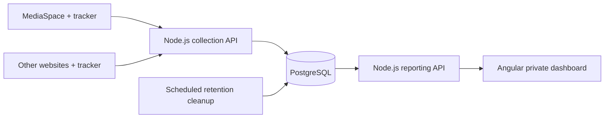

# Proposal: reusable website analytics

Date: September 29, 2026

Status: proposed; implementation has not started

Working name: Site Analytics

## 1. Purpose

Build a separate analytics application that the owner can connect to multiple websites without depending on those websites' frameworks. The application will collect visitor interaction events and provide a private dashboard for understanding traffic and engagement.

The owner prefers Angular, Node.js, PostgreSQL, and a standalone JavaScript tracker. The priorities are low recurring cost, control over collected data, and reuse across future projects.

This service measures activity after visitors arrive. It does not implement SEO or guarantee search rankings. MediaSpace's SEO work remains in its own repository and feature branch.

## 2. Initial assumptions

- One owner account manages multiple websites. Public signup and customer accounts are outside the first release unless the owner changes this scope.
- Deploy on the existing Ubuntu server as a separate service with separate configuration and data.
- Start at modest traffic levels. Establish a numerical traffic and retention target before designing load tests or sizing storage.
- ChatGPT/Codex assists one developer working close to full-time. Human review, setup, testing, and operational decisions remain part of the estimate.
- Begin with event analytics. Session replay is a later, separately scoped phase.
- No production website starts sending data merely because this proposal exists.

## 3. First-release scope

### Projects and access

- An authenticated private dashboard with secure owner account setup, logout, and a documented recovery procedure.
- Create and manage website projects with a public site ID, allowed origins, retention settings, and collection enable/disable controls.
- Keep dashboard credentials separate from public tracker identifiers. A public site ID is routing information, not an authentication secret.
- Separate each project's data in ingestion, reporting, and deletion paths.

### Browser tracking

- Initial page views and client-side navigation, including single-page applications.
- Anonymous session identifiers with a documented expiration definition; do not imply a session identifies a person.
- Page/referral information with an explicit URL sanitization policy.
- Selected clicks and explicit custom events rather than indiscriminate collection of element text or form values.
- Scroll milestones for both the document and designated scrolling containers.
- Batched delivery, bounded buffering, and best-effort sending when a page is hidden or closed.
- Event IDs and retry handling to avoid double counting.
- Consent/start/stop hooks, route exclusions, and an easy integration-level off switch.
- Tracker failures must not break the host website or create unbounded memory/network use.

Example integration shape, subject to implementation:

```html
<script
  defer
  src="https://analytics.example.com/tracker.js"
  data-site-id="PUBLIC_SITE_ID">
</script>
```

The tracker must also expose an API for consent and custom events. Loading the script must not implicitly override a website's consent policy. Native mobile applications are not covered by this browser tracker.

### Collection API and storage

- A versioned event schema with timestamp, event ID, site ID, session ID, event type, sanitized path, and bounded properties.
- Validate allowed event types, lengths, property counts, timestamps, batch sizes, and request content types.
- Apply rate limits and resource limits before expensive database work.
- Use site origin checks as one abuse signal; browser-origin restrictions alone do not authenticate a sender or prevent forged events.
- Store events in PostgreSQL using parameterized queries and appropriate indexes.
- Start with direct, bounded batch writes. Add queues or workers only when measured needs justify the operational cost.
- Schedule retention cleanup and provide project-data deletion.

### Reporting and dashboard

- Site selector and date-range filters.
- Page views, sessions, popular pages, referrers, and trends.
- Selected click/custom-event counts and scroll engagement.
- An anonymous session event timeline, clearly distinguished from a visual session replay.
- Explicit definitions for sessions, time zones, duplicate suppression, scroll percentages, and reporting delays.
- Empty states and clear errors when collection or reporting is unavailable.

## 4. Architecture



The dashboard can be built as static Angular assets and served through the reverse proxy. Node.js exposes collection endpoints and authenticated administration/reporting endpoints. PostgreSQL performs reporting aggregations; Node.js validates requests and returns results.

Use a single repository with clear boundaries, potentially:

```text
apps/dashboard/       Angular dashboard
apps/api/             Node.js collection, reporting, and administration
packages/tracker/     Standalone browser tracker
packages/contracts/   Shared event schema and validation contracts
docs/                 Setup, architecture, event definitions, and operations
```

Choose the Node.js HTTP framework, migration tool, chart library, and authentication approach during the first milestone. Do not add Redis, a message broker, or multiple database systems without a concrete need.

## 5. Privacy and data boundaries

- Collect only what is needed for the selected reports. Do not collect passwords, form contents, authorization headers, media access tokens, or arbitrary DOM text.
- Strip or allowlist query parameters and fragments; apply equivalent rules to referrer and custom-event data.
- Respect the host website's consent decision and exclude administration and protected content.
- Decide whether any IP-derived information is necessary. Avoid persisting raw IP addresses as an analytics field by default; operational logs need their own retention policy.
- Document anonymous identifiers, retention, access controls, and deletion behavior accurately. Self-hosting does not remove privacy obligations.
- Capture is inherently incomplete: blockers, disabled JavaScript, denied consent, connectivity, and browser shutdown can prevent delivery. Do not promise every visitor or every click.
- Bot/crawler request reporting is a separate server/gateway logging concern, outside this first browser-analytics scope.

## 6. MediaSpace integration

MediaSpace remains a separate application and repository. Its current Fullstory integration is disabled and is not a dependency of this service.

Use MediaSpace as the first pilot:

- Add the tracker through a configurable integration.
- Measure public photo/video overlay opens, selected sharing/navigation actions, and the feed's internal scrolling container.
- Exclude admin sessions and protected/unlisted content according to an explicit policy.
- Replace or disable the Fullstory integration when the first-party tracker is activated, avoiding duplicate collection.
- Verify the same tracker on a minimal second website to prove it is not coupled to Next.js or MediaSpace.

The analytics service and MediaSpace integration should be independently deployable and reversible.

## 7. Milestones and estimates

The [daily delivery plan](DAILY_PLAN.md) breaks these milestones into ordered workdays with concrete completion checks and a progress log.

Estimates assume one experienced developer working close to full-time with ChatGPT/Codex assistance. They include implementation and integration work, but depend on timely decisions and access to the development/deployment environment. No subscription guarantees a delivery speed.

| Milestone | Deliverable | Approximate effort |
| --- | --- | --- |
| 1. Design and foundation | Confirm scope, metrics, event schema, repository structure, and local setup | 1–2 working days |
| 2. Vertical prototype | A test page sends events through Node.js into PostgreSQL; basic reporting retrieves them | 2–3 working days |
| 3. Useful MVP | Angular dashboard, owner login, multiple sites, basic reports, and MediaSpace pilot integration | 2–5 additional working days |
| 4. Dependable release | Broader browser tests, abuse controls, retention, backup/restore, performance checks, and deployment documentation | 5–15 additional working days |

Planning targets:

- **Working prototype:** approximately 2–5 working days from implementation start.
- **Useful MVP:** approximately 1–2 weeks total.
- **Dependable first release:** approximately 3–5 weeks total, including buffer for integration and environment issues.

These targets overlap; they are not separate estimates to add together. A prototype is not ready for unrestricted production traffic. Re-estimate after milestone 2 using actual implementation progress and browser results. Part-time work extends the calendar timeline.

### Later session-replay phase

An rrweb-based recorder/player is a candidate, not an agreed dependency. Replay requires recording consent, masking, asset handling, compression, storage, playback, retention, and careful testing with dynamic applications.

Allow a provisional **3–6 additional weeks** for a usable replay phase after the event analytics foundation is stable. This is not an estimate for Fullstory feature parity. Revisit the estimate after a replay feasibility prototype and storage measurements.

## 8. Cost approach

- Use the existing server initially to avoid a separate hosting subscription where capacity permits.
- Track incremental disk, bandwidth, backup, and maintenance costs rather than describing self-hosting as cost-free.
- Limit retention and event volume; batch writes and measure query performance.
- Estimate storage using observed events per day × stored/indexed bytes per event × retention days, then account for database overhead and backups.
- Keep replay out of the initial storage budget because its data volume and asset needs differ substantially from ordinary event records.
- Review capacity before expanding to additional high-traffic sites.

## 9. Release acceptance criteria

- Two websites can send events to separate projects without cross-project report leakage.
- Direct visits and client-side navigation count correctly; retries do not inflate reports.
- Selected clicks, media overlays, and document/container scrolling produce the expected events.
- Consent denial and withdrawal stop collection as designed; protected content and sensitive URL data stay excluded.
- Malformed, oversized, and excessive requests are rejected without degrading the host websites.
- Dashboard totals match a controlled fixture dataset and expected time-zone boundaries.
- The tracker remains non-blocking when the analytics server is unavailable.
- Owner authentication protects reporting and administration endpoints.
- Retention cleanup works and database backup restoration has been tested.
- Deployment, rollback, health checks, logs, and disable procedures are documented.
- Browser checks cover a defined desktop/mobile browser set, and measured performance meets targets agreed during design.

## 10. Exclusions and decisions to confirm

Not in the first release: public customer registration, billing, native mobile SDKs, session replay, visual heatmaps, advanced funnels, cross-device identity, guaranteed bot identification, and Fullstory feature parity.

Confirm before implementation:

1. Is the single-owner, private-tool assumption correct?
2. What are the expected websites, daily event volume, and retention period?
3. Which dashboard reports matter most for the first pilot?
4. Which domain and server resources will host the service?
5. What consent behavior should each integrated website use?
6. What owner authentication/recovery approach is preferred?

## 11. Documentation and change control

Keep this proposal in `main`. Implement through feature branches and reviewable PRs. Update the proposal when scope changes, retain setup and operational instructions, and record completed milestones with actual validation results. Creating this repository does not authorize a production deployment or enable tracking on any website.
